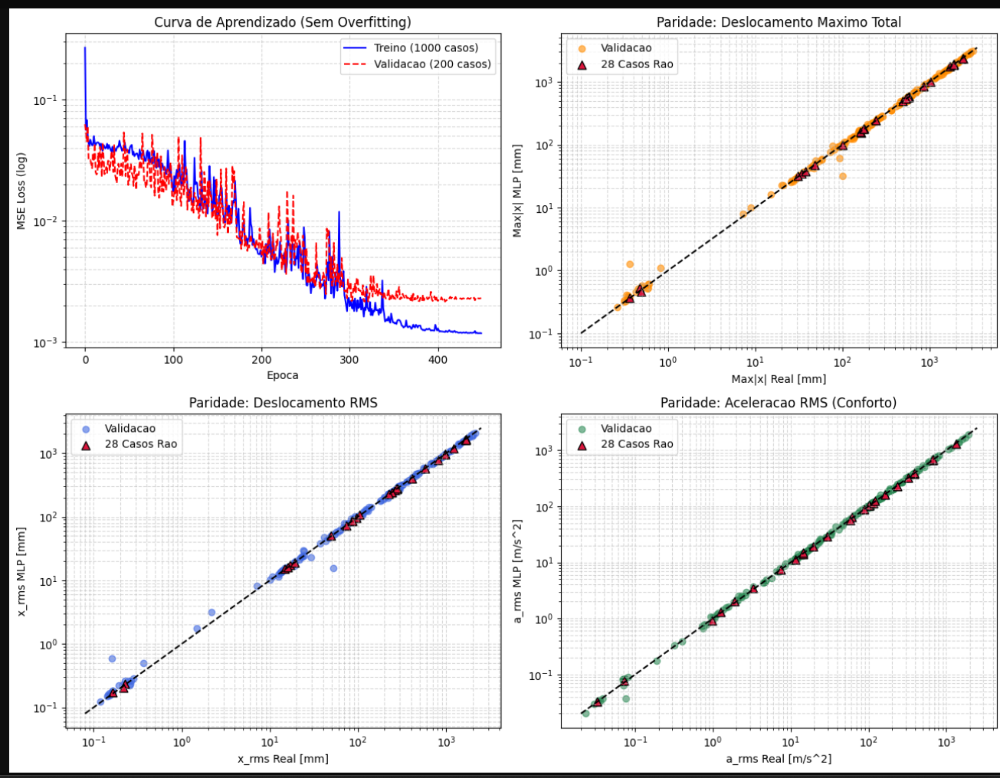

# PIBIC · Predição da resposta dinâmica de suspensão veicular

O projeto investiga redes neurais como modelos substitutos para estimar a resposta de suspensões passivas. A primeira etapa usa um oscilador de **1 grau de liberdade (GDL)** para verificar a geração de dados e o treinamento. A etapa seguinte aplica o procedimento ao quarto de veículo de **2 GDL**, com movimentos separados da carroceria e da roda.

| Etapa | Material no repositório | Estado |
|---|---|---|
| Oscilador harmônico de 1 GDL | Solução analítica, RK4 em MATLAB, 28 casos de Rao e banco de 1.228 simulações | Conferência numérica concluída |
| MLP de 1 GDL | Scripts PyTorch e MATLAB, partições, gráficos e relatório | Prova de conceito para cinco indicadores |
| Expansão de 1 GDL | Gerador e 1.260 simulações com degrau, impulso e ruído filtrado | Banco gerado e verificado. Treinamento conjunto pendente |
| Quarto de veículo de 2 GDL | Protótipo MATLAB, demonstrações, gráficos e banco preliminar de 5.000 configurações | Revisão dos perfis de pista e dos alvos em andamento |
| Comparação experimental | Protocolo e referências públicas | Dados externos selecionados para comparação futura |

## Resultados de 1 GDL

A MLP recebe parâmetros físicos de uma simulação e estima amplitude em regime permanente, pico de deslocamento e RMS de deslocamento, velocidade e aceleração. O relatório registra **1,77% de MAPE para deslocamento RMS** e **2,38% para aceleração RMS** nos 28 casos de referência. Todos esses casos originaram variações de treino e validação. Uma divisão por famílias ainda é necessária para avaliar generalização.

A figura registra o resultado original. Veja a [leitura crítica das métricas, da curva e dos rótulos](docs/metodologia.md).

Na expansão, foram gerados **90 degraus, 90 impulsos e 1.080 casos de ruído**. As quatro bandas foram definidas em relação à frequência natural. Com a mesma força RMS por sistema e nível, a banda em torno da ressonância teve a maior mediana de deslocamento RMS. Veja os [resultados por banda e a verificação com RK4](docs/expansao-1gdl.md).

## Reprodução

Use Python 3.11 ou mais recente. Os comandos abaixo partem da raiz do repositório.

**Gerar o banco expandido e exportar uma série de exemplo**

~~~powershell
python -m pip install numpy
New-Item -ItemType Directory -Force gerados | Out-Null
python src/1gdl/expansao/gerar_banco_1gdl.py dados/1gdl/harmonico/dataset_completo_treinamento_suspensao_1dof.csv gerados/banco_1gdl_excitacoes.csv
python src/1gdl/expansao/gerar_banco_1gdl.py gerados/banco_1gdl_excitacoes.csv gerados/exemplo_serie.csv --serie G01-V0-A1-ruido-larga-1
~~~

**Repetir o treinamento original em PyTorch**

~~~powershell
python -m pip install -r requirements-mlp.txt
New-Item -ItemType Directory -Force gerados/mlp | Out-Null
Copy-Item dados/1gdl/harmonico/banco_*.csv gerados/mlp/
Push-Location gerados/mlp
python ../../src/1gdl/mlp/treinar_mlp_sdof.py
Pop-Location
~~~

O script usa GPU se CUDA estiver disponível e grava a figura e a tabela de previsões na pasta de execução. As sementes são fixas. Os resultados podem variar conforme o ambiente. A [versão MATLAB](src/1gdl/mlp/treinar_mlp_sdof.m) usa outra arquitetura e requer Deep Learning Toolbox. Rode a partir de uma pasta com os mesmos três CSVs.

Em MATLAB, execute [run_all.m](src/1gdl/matlab-rao/run_all.m) em uma cópia de trabalho da pasta para recalcular os casos de Rao. O [lote de 2 GDL](src/2gdl/matlab/automacao_simulacoes.m) lê o CSV base de 5.000 configurações na pasta de execução e grava um novo CSV. Para reproduzir esse lote, copie o CSV e os três scripts de src/2gdl/matlab para uma pasta separada e execute automacao_simulacoes nessa pasta.

O [exemplo de validação de 40 kg](src/1gdl/matlab-validacao/validacao_sdof_rk4.m) tem sua própria cópia do integrador. Execute o exemplo a partir da pasta dele para usar a versão correspondente. As [demonstrações de 2 GDL](src/2gdl/demos/) e as [figuras arquivadas](resultados/) registram explorações do modelo e dos perfis C e D. Consulte a metodologia antes de interpretar os rótulos de pista dessas demonstrações.

## Documentação

- [Modelos, critérios, resultados e próximos passos](docs/metodologia.md)
- [Dicionário dos CSVs](docs/dados.md)
- [Análise de degrau, impulso e ruído por faixa](docs/expansao-1gdl.md)
- [Protocolo de comparação experimental](docs/comparacao-experimental.md)
- [Bibliografia comentada e materiais consultados](docs/referencias.md)
- [Relatório técnico original](docs/relatorio-tecnico-original.pdf)

Livros, artigos, normas e bancos externos são creditados por meio de referências e links para as fontes.
